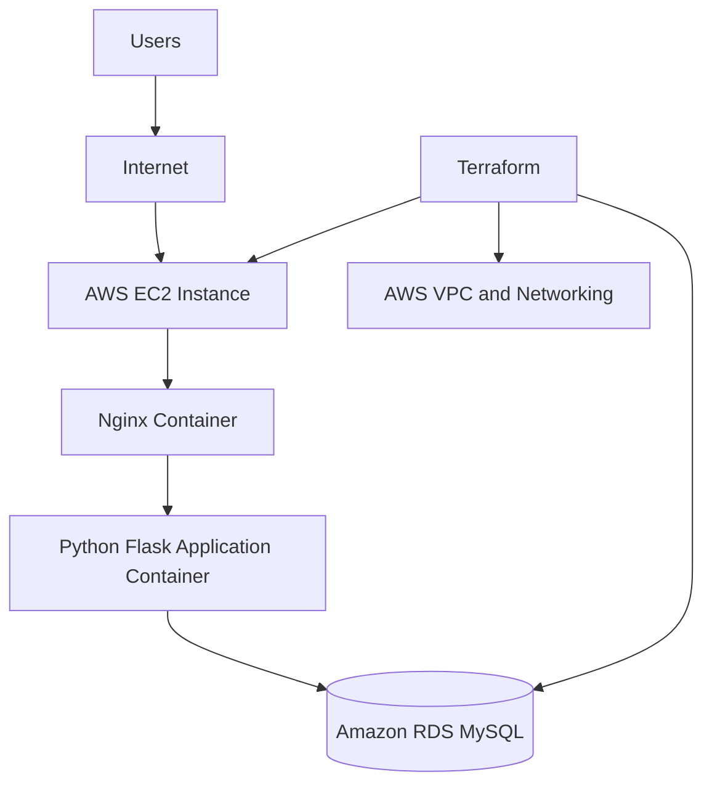

# Three-Tier E-Commerce Application | AWS | Docker | Terraform

A containerized three-tier E-Commerce application deployed on AWS using Docker, Docker Compose, Nginx, Amazon EC2 and Amazon RDS (MySQL). The cloud infrastructure is provisioned using Terraform.

This project demonstrates the deployment of a real-world web application with separate application and database layers, containerization and cloud infrastructure automation.

## Architecture



## Technologies Used

| Technology | Purpose |
|---|---|
| AWS EC2 | Application hosting |
| AWS RDS | Managed MySQL database |
| AWS VPC | Network infrastructure |
| Terraform | Infrastructure as Code |
| Docker | Application containerization |
| Docker Compose | Multi-container management |
| Nginx | Web server and reverse proxy |
| Python Flask | Backend application |
| MySQL | Relational database |
| Git & GitHub | Version control |

## Project Overview

The application is deployed using a container-based architecture on AWS.

The application runs inside Docker containers on an EC2 instance, while the database is hosted separately using Amazon RDS.

Terraform is used to provision the required AWS infrastructure, making the deployment more organized and repeatable.

## Application Architecture

**1. Web Server – Nginx**
- Receives incoming HTTP requests.
- Acts as a reverse proxy.
- Forwards requests to the Flask application.

**2. Application Layer – Python Flask**
- Handles application logic.
- Processes user requests.
- Communicates with the MySQL database.

**3. Database Layer – Amazon RDS**
- Uses managed MySQL.
- Stores application data.
- Runs separately from the application containers.

## AWS Infrastructure

The AWS infrastructure includes:

- VPC for network isolation.
- Public and private networking components as configured.
- EC2 instance for application deployment.
- Amazon RDS for database management.
- Security Groups for controlling network access.

Infrastructure is provisioned using Terraform.

## Docker Implementation

The application is containerized using Docker.

Docker Compose manages the application and Nginx containers.

Benefits:
- Consistent application environment.
- Simplified container management.
- Easier application deployment.
- Separation of application and database hosting.

## Application Deployment Workflow

1. Provision AWS infrastructure using Terraform.
2. Connect to the EC2 instance using SSH.
3. Install and configure Docker.
4. Clone the application repository.
5. Configure database environment variables.
6. Build the Docker images.
7. Start application containers using Docker Compose.
8. Configure the application to connect to Amazon RDS.
9. Access the application through the EC2 public endpoint.

## Repository Structure

```text
three-tier-ecommerce-application/
│
├── nginx/
│   └── Nginx configuration files
│
├── static/
│   └── css/
│
├── templates/
│   └── HTML templates
│
├── app.py
├── config.py
├── models.py
├── requirements.txt
├── dockerfile
├── docker-compose.yml
├── .dockerignore
└── .gitignore
```

## Security Considerations

- Database credentials are configured through environment variables.
- Sensitive configuration files should not be committed to GitHub.
- AWS Security Groups control inbound and outbound traffic.
- The database should not be publicly accessible.
- Application and database communication should use secure network configurations.


## What I Learned

Through this project, I gained hands-on experience with:

- Deploying a web application on AWS EC2.
- Creating cloud infrastructure using Terraform.
- Working with AWS VPC and Security Groups.
- Containerizing applications using Docker.
- Managing multiple containers using Docker Compose.
- Configuring Nginx as a reverse proxy.
- Connecting a containerized application to Amazon RDS.
- Managing application deployment through SSH.
- Using Git and GitHub for version control.

## Future Improvements

- Implement Kubernetes orchestration using Amazon EKS.
- Automate application deployment using GitHub Actions.
- Implement monitoring using Prometheus and Grafana.
- Configure HTTPS using AWS Application Load Balancer and ACM.
- Implement automated scaling and health checks.

##  Related Repository

**Terraform Infrastructure Repository:**

[aws-terraform-infrastructure](https://github.com/Ajaylogaom1/aws-terraform-infrastructure)

## Author

**Ajay**

GitHub: [@Ajaylogaom1](https://github.com/Ajaylogaom1)

